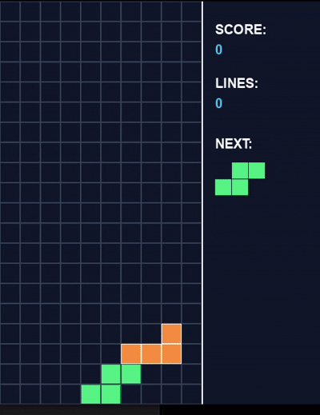

# 🧱 Python Tetris
This is My first game btw

A polished desktop Tetris built with Pygame, designed to run natively on
Linux (tested on CachyOS / Arch).

## ✨ Features

- **Full screen flow:** Main Menu → Playing → Paused → Game Over, plus a
  persistent High Scores table.
- **Interactive menus:** mouse-driven buttons with hover states, and matching
  keyboard shortcuts for everything.
- **Difficulty scaling:** gravity speeds up every 10 lines, and the level
  multiplier applies to line-clear scores.
- **Local high scores:** the top 5 runs are saved to `high_score.json` next to
  the script (atomic writes, corruption-safe loading).
- **Comfort features:** 7-bag randomiser, ghost piece, wall kicks, hard drop,
  soft-drop scoring, delayed auto-shift for smooth horizontal movement.
- **Clean visuals:** gradient background, rounded blocks, grid borders,
  monospaced score readouts and a well-aligned sidebar layout.

## 📦 Download (prebuilt binary)

Every tagged release ships ready-to-run assets:

| Asset | What it is |
| --- | --- |
| `tetris-<version>-linux-x86_64` | Standalone executable — **no Python or Pygame required** |
| `tetris-<version>-source.zip` | Sources + launcher + installer + icon |
| `SHA256SUMS.txt` | Checksums to verify your download |

```bash
chmod +x tetris-*-linux-x86_64
./tetris-*-linux-x86_64
```

The frozen build keeps its high scores in
`~/.local/share/tetris/high_score.json` (respects `XDG_DATA_HOME`), because a
one-file bundle runs from a temporary directory that is deleted on exit.
Running from source still writes `high_score.json` next to the script.

> **Note:** the binary is built for `x86_64` Linux and links against the glibc
> of the build machine (CachyOS/Arch, glibc 2.42). It runs on equally recent
> distros; on older ones, use the source archive instead.

## 🚀 Setup

```bash
cd tetris
python3 -m venv .venv
source .venv/bin/activate
pip install -r requirements.txt
python tetris.py
```

Requires Python 3.10+ and Pygame 2.5+. On CachyOS/Arch you can also use the
system package instead of a venv: `sudo pacman -S python-pygame`.

## 🖱 Running it like a real app

The repo ships a `tetris` launcher (a self-locating shell script) so you don't
need to activate a virtualenv or remember paths:

```bash
./tetris                # from the project folder
```

It prefers `.venv/bin/python` when present and otherwise falls back to system
`python3`, and prints install instructions if Pygame is missing.

To add a **Tetris** entry with an icon to your CachyOS application menu:

```bash
./install-desktop.sh
```

That writes `~/.local/share/applications/tetris.desktop` plus the icon into the
hicolor theme (no `sudo` needed). Remove it later with:

```bash
rm ~/.local/share/applications/tetris.desktop
```

## 🎮 Controls

| Action | Keys |
| --- | --- |
| Move left / right | `←` / `→` (hold to auto-repeat) |
| Soft drop | `↓` (hold) |
| Rotate clockwise | `↑` or `X` |
| Rotate counter-clockwise | `Z` |
| Hard drop | `Space` |
| Pause / resume | `P` or `Esc` |
| Restart | `R` |
| Menu navigation | Mouse click, or `Enter` / `H` / `Q` |

## 📺 Gameplay



## 🗂 Project layout

| File | Purpose |
| --- | --- |
| `tetris.py` | The game (single modular file) |
| `tetris` | Launcher script — `./tetris` |
| `install-desktop.sh` | Adds a menu entry + icon to your desktop |
| `build-release.sh` | Builds the release binary + source archive into `dist/` |
| `icon.png` | Application icon (256×256) |
| `requirements.txt` | Pygame dependency |

`tetris.py` is intentionally a single, modular file:

- configuration constants, palette and tetromino data
- rendering helpers (fonts, text, blocks, panels, gradient background)
- `HighScoreStore` — JSON persistence
- `Tetromino` / `Board` — game model
- `Button` — reusable hover-aware widget
- `TetrisGame` — state machine, input, update and rendering

## 🔧 Building a release

```bash
./build-release.sh v1.0.0     # or with no argument to use `git describe`
```

This freezes a standalone executable with PyInstaller, zips the sources and
writes `SHA256SUMS.txt` into `dist/`. To publish it:

```bash
gh release create v1.0.0 dist/* --title "Tetris v1.0.0" --generate-notes
```
